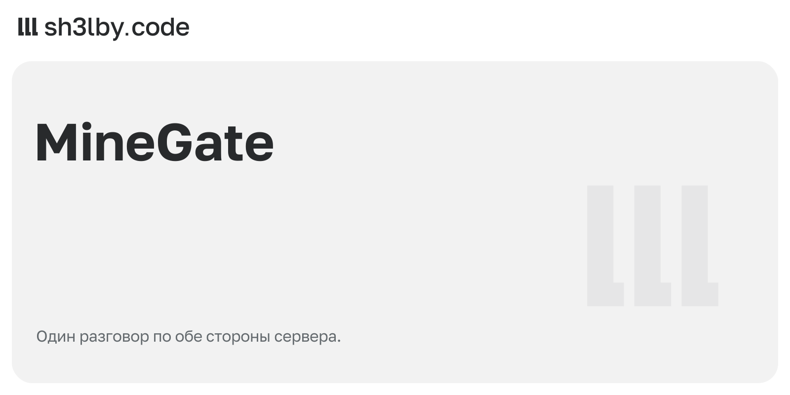

# MineGate Plugin

<!-- portfolio-card:start -->
[](docs/portfolio/card.svg)
<!-- portfolio-card:end -->

Telegram ↔ Minecraft Bridge Plugin for Paper 1.21+

## Описание

MineGate - это плагин для Minecraft Paper серверов, который обеспечивает двустороннюю синхронизацию чата между сервером Minecraft и Telegram-группой без привязки аккаунтов. Плагин поддерживает reply-контекст и выполнение кастомных серверных команд через Telegram.

## Возможности

- ✅ Двусторонняя синхронизация чата (Minecraft ↔ Telegram)
- ✅ Reply-контекст с hover-текстом в Minecraft
- ✅ Выполнение кастомных команд из Telegram
- ✅ Системные события (join/quit/death/server start/stop)
- ✅ Long polling (без webhook)
- ✅ Неблокирующий main thread
- ✅ Отказоустойчивость при проблемах с Telegram

## Требования

- Paper 1.21+
- Java 17+
- Telegram Bot Token

## Установка

1. Скачайте последнюю версию плагина
2. Поместите файл `MineGate.jar` в папку `plugins` вашего сервера
3. Запустите сервер для создания конфигурационного файла
4. Отредактируйте `plugins/MineGate/config.yml`:
   - Укажите `telegram.token` (получите у @BotFather)
   - Укажите `telegram.chat-id` (ID вашей Telegram группы)
   - При необходимости выключите `events.*` если системные сообщения в Telegram не нужны
5. Перезапустите сервер

## Конфигурация

Файл `config.yml` содержит следующие секции:

### Telegram
- `token` - токен бота от @BotFather
- `chat-id` - ID Telegram группы (можно получить у @userinfobot)
- `poll-timeout-seconds` - timeout для long polling (по умолчанию 20)

### Bridge
- `enabled` - включить/выключить мост
- `read-only` - только чтение (Minecraft → Telegram)
- `cooldown-ms` - задержка между сообщениями от одного игрока
- `max-message-length` - максимальная длина сообщения

### Reply
- `enabled` - включить reply-контекст
- `max-age-seconds` - время жизни reply-контекста (по умолчанию 3600)

### Events
- `join` - отправлять события входа игроков (`true` по умолчанию)
- `quit` - отправлять события выхода игроков (`true` по умолчанию)
- `death` - отправлять сообщения о смерти (`true` по умолчанию)
- `server` - отправлять события старта/остановки сервера (`true` по умолчанию)

### Custom Commands
Настройка кастомных команд для выполнения из Telegram:

```yaml
custom-commands:
  ping:
    need-player: true
    command: "ping %player%"
    description: "Пинг игрока"
    max-output-lines: 15
  
  online:
    need-player: false
    command: "list"
    description: "Онлайн игроков"
    max-output-lines: 15
```

## Использование

### Команды Telegram

- `/help` - список доступных команд
- `/online` - если настроено в конфиге
- `/ping <player>` - если настроено в конфиге

Неизвестные команды молча игнорируются.

### Формат сообщений

**Minecraft → Telegram:**
```
⛏ PlayerName: сообщение
```

**Telegram → Minecraft:**
```
[TG] @username: сообщение
```

**Reply в Minecraft:**
```
@TelegramUser [в ответ PlayerName]: ответ
```
(при наведении на `[в ответ PlayerName]` показывается оригинальное сообщение)

## Сборка

```bash
mvn clean package
```

Готовый JAR файл будет в `target/MineGate-1.0.0.jar`

## Лицензия

MIT License

## Поддержка

При возникновении проблем создайте issue в репозитории проекта.
